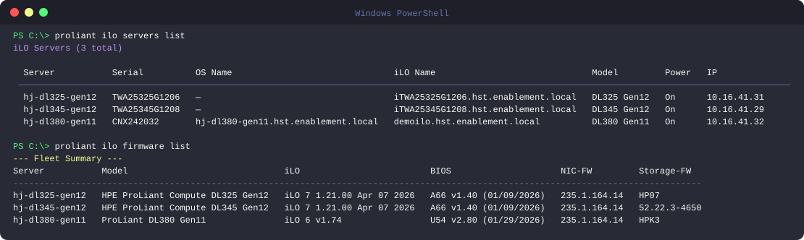

# iLO

`proliant ilo` talks directly to a server's iLO over Redfish. It requires a
local inventory file with the server's iLO address and credentials; run
[`proliant setup`](index.md#connect-your-first-server) to create one.

## Inventory

```bash
proliant ilo servers list                        # List all configured hosts
proliant ilo servers describe <host>              # Full server details
proliant ilo power describe <host>                # Power state + auto power-on after AC power loss
```

## Automation and AI agents

`proliant ilo inventory` always prints JSON with a stable, versioned schema,
so scripts and AI agents can consume it without parsing tables:

```bash
proliant ilo inventory                                  # summary for every server
proliant ilo inventory <host> --resources summary,gpu,power
proliant ilo inventory --resources all
```

```json
{
  "schema_version": 1,
  "collected_at": "2026-11-06T06:07:59+00:00",
  "resources": ["summary", "gpu"],
  "servers": {
    "dl325-gen12": {"summary": {"model": "...", "power_state": "On", "ilo": {"firmware": "1.21.00"}}, "gpu": []},
    "unreachable-host": {"error": "ConnectError: ..."}
  }
}
```

Resources: `summary`, `power`, `firmware`, `cpu`, `gpu`, `memory`, `storage`,
`network`, `network_ilo`, `boot`, `bios`, `license` (`proliant ilo inventory --help`
describes each). A failing server or resource becomes an `{"error": ...}` entry
without affecting the rest. `--json` also works on `servers describe` (all
resources, same schema), `storage`/`network`/`network-ilo describe`,
`reports cpu|gpu|memory` and `bios describe`. Change commands support `--dry-run`
(`power`, `uid`, `boot set pxe`) to preview the exact Redfish request.

In Python, use the same data in-process:

```python
from proliant.ilo import api
api.query(["summary", "gpu"], server="dl325-gen12")
```

## Screenshots



<!--
  ADD MORE REAL-USAGE SCREENSHOTS HERE (zero rebuild — just push):
  1. Drop a PNG into  docs/assets/  (e.g. ilo-firmware-table.png)
  2. Add another image line below, e.g.:

  
-->

